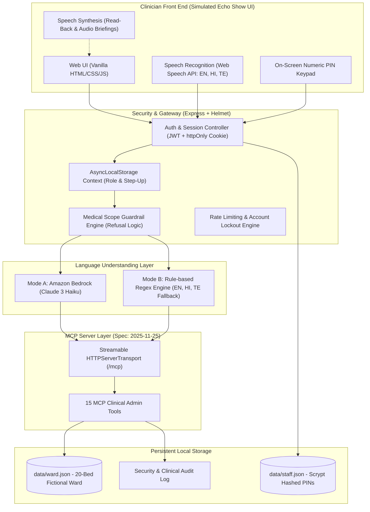

# WardOS: Voice-First Hospital Ward Assistant (Alexa+ MCP)

> **Simulated Alexa+ experience powered by an MCP server. Not a medical device. Not for real patient data.**  
> Built for the Amazon Developer Hackathon (Alexa+ Track).

---

## 1. Problem Statement
In hospital inpatient wards across India, medical teams face high administrative friction:
- **Time Lost to Paperwork & Verbal Handovers**: Doctors and nurses spend up to 35% of their shifts writing handover notes, transcription checklists, and routine admin logs.
- **Communication Gaps Between Shifts**: Critical pending lab tests, radiology reports, and administrative tasks get lost during shift handovers.
- **Sterile Environment Constraints**: During ward rounds, clinicians cannot type on keyboards or touch screens with soiled gloves or while examining patients.
- **Multilingual Reality**: Indian hospital teams frequently communicate in a natural blend of English, Hindi/Hinglish, and regional languages like Telugu.

## 2. Solution: WardOS
**WardOS** is a voice-first, hands-free administrative assistant designed specifically for hospital ward teams. Clinicians speak naturally in **English, Hindi/Hinglish, or Telugu** during rounds and shift transitions. WardOS keeps the ward board, tasks, pending diagnostics, discharge paperwork, and shift handovers coordinated in real time.

The **Model Context Protocol (MCP)** server is the foundational product. While Alexa+ represents the first ambient voice front-end, the exact same MCP server can connect to nurse-station displays, mobile applications, or hospital information systems (HIS/EHR).

---

## 3. Strict Safety and Scope Rules (Non-Negotiable)

1. **ADMINISTRATIVE ONLY**:
   WardOS records, coordinates, and organizes administrative workflow items. It **never diagnoses**, **never suggests drugs, doses, or treatment plans**, **never interprets vitals or laboratory results**, and **never offers medical advice**. When asked clinical questions, it politely refuses and states its administrative scope.
2. **SYNTHETIC DATA ONLY**:
   All patient names, bed assignments, and administrative records are purely fictional. The interface displays a persistent warning banner.
3. **CLINICIAN APPROVES EVERYTHING**:
   Handover notes and round notes are generated strictly as **DRAFTS**. They require clinician review and on-screen PIN step-up confirmation before becoming **APPROVED**. Shift handovers require an audible **"Read back and confirm"** step.
4. **NEVER ADD CONTENT**:
   WardOS never infers clinical details or fills in unstated information. Unstated fields are explicitly displayed as `"Not stated"`.
5. **AUDIT LOG**:
   Every action (create, edit, approve, complete, login, lockout, permission denial) is logged with the user role, timestamp, and spoken/typed text.
6. **SIMULATED DISCLAIMER**:
   Every page displays: *"Simulated Alexa+ experience powered by an MCP server. Not a medical device. Not for real patient data."*

---

## 4. Architecture



---

## 5. Security & Threat Model

### Threat Model (Plain Language)
- **Unauthorized Ward Access**: Unauthenticated visitors or unauthorized staff attempting to view ward occupancy or tasks.
  - *Mitigation*: Mandatory on-screen PIN login with scrypt hashing, short-lived 15-minute JWT session tokens, and strict 2-minute auto-lock with a 15-second countdown warning.
- **Voice PIN Snooping (Shoulder Surfing / Eavesdropping)**: In a busy hospital ward, speaking a security PIN aloud would leak credentials to anyone nearby.
  - *Mitigation*: The system **never accepts or asks for PINs by voice**. PIN entry is strictly on-screen via a numeric touch keypad.
- **Role Elevation**: A nurse attempting to perform doctor-restricted clinical actions (e.g., approving shift handovers or admitting patients).
  - *Mitigation*: Server-side role enforcement derived solely from the signed session token. Client-supplied role attributes in request bodies are ignored.
- **Accidental Voice Triggering of High-Risk Actions**: Ambient ward noise triggering an accidental patient discharge or handover approval.
  - *Mitigation*: Step-up authentication requiring an on-screen PIN within the preceding 60 seconds before executing high-risk actions (`approve_handover`, `approve_round_note`, `admit_patient`, `start_discharge`).
- **DNS Rebinding & Unauthorized API Calls**:
  - *Mitigation*: `/mcp` requires a valid Bearer token, validates the `Origin` header against allowed origins, and binds strictly to `127.0.0.1` by default.
- **Data & Credential Leakage**:
  - *Mitigation*: Server console logs are sanitized to record only HTTP method, path, status, and duration. PINs, patient names, and notes are never printed to server logs.

### Honest "Not Production Ready" List
For a production deployment in an accredited Indian hospital, the following additions would be required:
1. **Transport Security**: Enforce HTTPS / TLS 1.3 across all endpoints with mutual TLS (mTLS) for hospital device communication.
2. **Enterprise Identity Provider (SSO)**: Integration with hospital directory services (Active Directory, SAML 2.0, OAuth2/OIDC) and RFID smart badge tap authentication.
3. **Hardware-Backed Badges**: Physical NFC badge readers at nurse stations instead of on-screen PINs.
4. **Encrypted Storage at Rest**: Encrypted database (e.g., PostgreSQL with pgcrypto / AWS RDS KMS encryption) replacing the local JSON file.
5. **Regulatory Compliance**: Full certification under India's **Digital Personal Data Protection Act (DPDP Act 2023)**, ABDM (Ayushman Bharat Digital Mission) standards, and international HIPAA guidelines.
6. **Clinical Validation**: Rigorous multi-center human-factors evaluation before clinical adoption.

---

## 6. Demo Staff Credentials

The system comes pre-seeded with 4 fictional staff accounts. PIN entry is **on-screen only**:

| Staff Name | Role | Demo PIN | Purpose |
| :--- | :--- | :--- | :--- |
| **Dr. Aarav Sharma** | Doctor | `1122` | Lead rounding physician & handover sign-off |
| **Dr. Priya Patel** | Doctor | `3344` | Attending physician |
| **Nurse Ananya Rao** | Nurse | `5566` | Ward charge nurse (tasks, reports, vitals) |
| **Nurse Rajesh Kumar** | Nurse | `7788` | Staff nurse |

---

## 7. Setup and Run

### Prerequisites
- Node.js v20+ or v24+
- npm v10+

### Installation
```bash
git clone <repo-url> wardos
cd wardos
npm install
```

### Environment Configuration
Copy `.env.example` to `.env`:
```bash
cp .env.example .env
```
Default configuration runs locally out-of-the-box in rule-based NLU mode (Mode B).

### Running the App
```bash
# Start in production mode:
npm start

# Or start in watch mode for development:
npm run dev
```
Open **[http://127.0.0.1:3000](http://127.0.0.1:3000)** in Chrome, Edge, or Safari.

### Running Test Suites
WardOS includes three comprehensive automated test suites:

```bash
# 1. MCP Tools Suite (calls all 15 MCP tools over Streamable HTTP transport):
npm run test:tools

# 2. Language Understanding Suite (30 test sentences across EN, HI, TE + 5 medical advice refusals):
npm run test:chat

# 3. Security Hardening Suite (auth, roles, auto-lock, step-up PIN, lockout, origin protection):
npm run test:security
```

---

## 8. Interactive Demo Mode

WardOS includes an **automated 3-minute scripted demonstration** that runs directly in the browser without requiring microphone permissions:
1. Click the cyan **"Run Interactive Demo"** button in the top banner.
2. Watch the on-screen captions progress through:
   - Staff login as Dr. Aarav Sharma
   - Morning spoken shift brief
   - Walking through ward rounds (Bed 1 & Bed 2)
   - Dictating a round note draft and step-up approving it
   - Switching role to Nurse Ananya Rao
   - Adding tasks and marking lab reports received
   - Starting a discharge checklist
   - **Security Proof**: Nurse attempting to approve a handover (blocked by role enforcement!)
   - Doctor re-authenticating and generating a shift handover draft
   - Handover read-back with audio synthesis & step-up PIN confirmation
   - **Safety Proof**: Voice query asking for antibiotic advice (politely refused by administrative guardrail)
   - Opening the Security Audit Log
   - End-of-shift summary with estimated time saved

---

## 9. Amazon Bedrock Integration (Mode A)

WardOS supports optional LLM processing via **Amazon Bedrock**:
1. In `.env`, set:
   ```env
   BEDROCK_ENABLED=true
   AWS_REGION=us-east-1
   AWS_ACCESS_KEY_ID=your_access_key
   AWS_SECRET_ACCESS_KEY=your_secret_key
   BEDROCK_MODEL_ID=anthropic.claude-3-haiku-20240307-v1:0
   ```
2. Required AWS IAM permission:
   ```json
   {
     "Version": "2012-10-17",
     "Statement": [
       {
         "Effect": "Allow",
         "Action": ["bedrock:InvokeModel"],
         "Resource": "arn:aws:bedrock:*:*:foundation-model/anthropic.claude-3-haiku-20240307-v1:0"
       }
     ]
   }
   ```
3. Check status at `http://127.0.0.1:3000/api/health`. If Bedrock times out or credentials are not supplied, WardOS automatically falls back to Mode B (Rule-based NLU).

---

## 10. Future Work
- **Native Alexa+ Device Skill**: Packaging the MCP client for direct Alexa+ Echo Show deployment.
- **Nurse-Station Ambient Array**: Ceiling-mounted directional microphones with noise-canceling for busy wards.
- **FHIR / ABDM Interoperability**: Bi-directional synchronization with India's Ayushman Bharat Digital Mission (ABDM) and FHIR R4 clinical repositories.
- **Expanded Regional Languages**: Support for Tamil, Kannada, Marathi, Bengali, and Gujarati.
